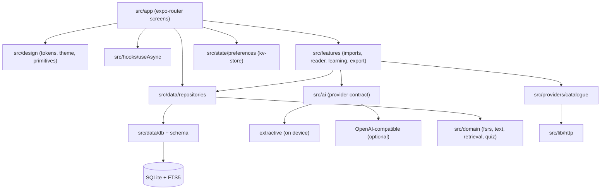
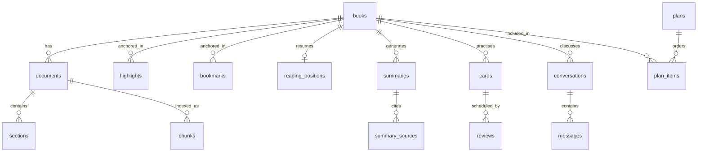
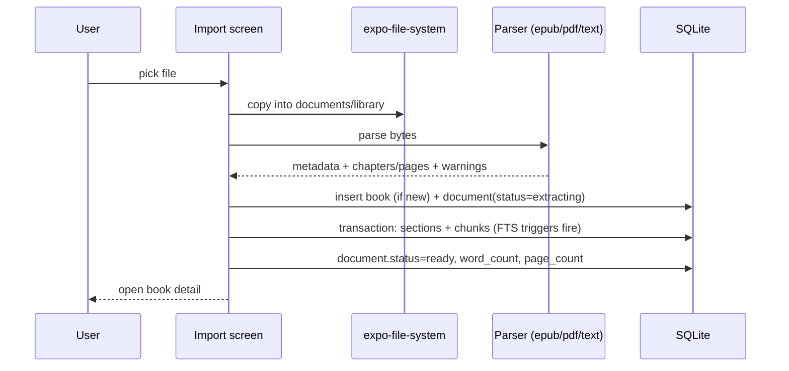
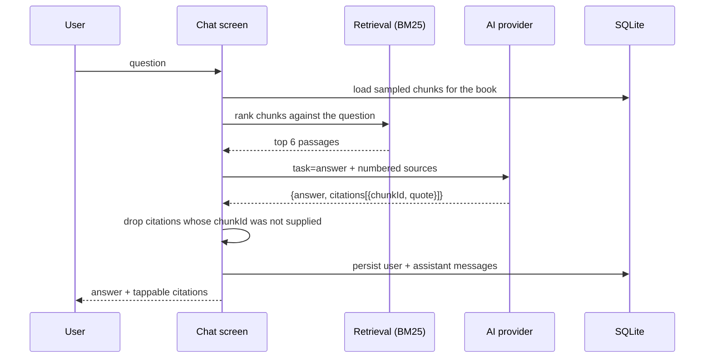

# Freehaven architecture

Local-first, single-binary client. No server is required for anything except catalogue metadata and an optional
remote model.

## 1. Layering



Rules that keep the graph acyclic:

- `domain/` depends on nothing but types. It is pure and unit-tested.
- `data/repositories` may use `domain` helpers but never screens or features.
- `features/` composes domain + repositories + providers; it never imports UI.
- `app/` is the only layer allowed to know about routing, theme and layout.
- `ai/` depends on `domain` only, so a provider can be tested without a database.

## 2. Data model

SQLite is the source of truth. Documents and media live on the filesystem; rows hold paths, metadata and offsets.



Key decisions:

| Decision | Why |
|---|---|
| `sections.text` stored alongside chunks | The reader renders chapter/page text directly, while chunks are the retrieval unit. Storing both avoids reconstructing text from overlapping chunks. |
| Character offsets on sections and chunks | Citations, highlights and search hits can point back to an exact passage without re-parsing the source. |
| Highlights stored as a JSON locator `{sectionId, para, start, end}` | Survives restarts and text re-renders; independent of DOM structure or WebView identity. |
| FTS5 kept in sync with triggers | Search works the moment a document is indexed, with no reindex step. |
| Cards carry `source_chunk_id` | Every question can show the passage it came from; review UI loads that chunk lazily. |
| Reviews are append-only | Scheduling history is auditable and replayable; the card row is the current projection. |
| Binary content out of the database | Keeps the DB small and backup/export cheap. |

Schema version is tracked in `PRAGMA user_version`; migrations run in a transaction and refuse to open a database
created by a newer build (`src/data/db.ts`).

### Storage footprint

`books`, `documents`, `sections`, `chunks`, `highlights`, `bookmarks`, `reading_positions`, `summaries`,
`summary_sources`, `cards`, `reviews`, `plans`, `plan_items`, `conversations`, `messages`, `jobs`, `downloads`,
`topics`, `settings`, plus the `chunks_fts` index.

## 3. Core flows

### Import → index



Failure path: the document row moves to `failed` with the parser message, the job row records the error, and no
sections/chunks are committed (the extraction write is one transaction).

### Read → highlight

1. Reader loads sections for the document and the persisted locator.
2. It renders a generated HTML document: paragraphs carry `data-p`, and stored highlights are wrapped in `<mark>`.
3. WebView JS reports selection with `{para, start, end}` computed from `Range.toString()` inside the paragraph.
4. The app stores a `highlights` row with the JSON locator, then injects the new paragraph HTML so the mark appears
   without reloading or losing scroll position.
5. Scroll percentage is debounced into `reading_positions` and drives Today/Discover progress.

### Ask → answer with evidence



If citations are empty after filtering and the task requires grounding, the client falls back to the extractive
answer so the user still sees evidence rather than an unsourced claim.

### Review → schedule

`schedule(card, grade, now)` is a pure function (FSRS-5, default 19 weights, no fuzzing). `reviewCard()` runs a
transaction: read card → compute → update card → append review. The same function powers the interval preview on
each grade button, so the UI and the persisted schedule cannot diverge.

## 4. AI provider contract

```ts
interface AiProvider {
  id: string;
  label: string;
  isAvailable(): Promise<boolean>;
  generate(request: AiRequest): Promise<AiResponse>;
}
```

- `AiRequest` carries the task, the user question and an array of **retrieved** sources (`chunkId`, text, page).
- `AiResponse` must return citations that reference those ids. The remote client validates them; the extractive
  client builds them by construction.
- The remote client is OpenAI-compatible (`/chat/completions`) and works with OpenAI, Groq, Together, a local
  llama.cpp server or an Ollama shim.
- The API key lives in SecureStore only. It is never persisted in the zustand store, never logged and never bundled.
- Any network or parse failure degrades to the extractive engine and says so in the answer.

## 5. Design system

- Three palettes share one semantic contract: `light`, `dark`, `reading` (warm paper). Screens never hard-code colour.
- Typography: Georgia/system serif for reading surfaces, system sans for UI, a compact scale from `caption` to
  `display`.
- Components: `AppText`, `Screen`, `Header`, `Button`, `IconButton`, `Card`, `Chip`, `ProgressBar`, `Cover`,
  `EmptyState`, `ErrorState`, `LoadingBlock`, `SectionHeader`, `Stat`, `Field`, `Sheet`, `Reveal`, `Markdown`.
- Touch targets ≥ 44 pt, explicit `accessibilityRole`/`accessibilityLabel`/`accessibilityState` on interactive
  components, progress exposed as `accessibilityValue`.
- Motion is limited to a 260 ms fade/translate reveal; no motion is required to understand state.

## 6. Failure modes and handling

| Failure | Behaviour |
|---|---|
| Catalogue provider down/slow | `Promise.allSettled` per provider; partial results shown with a non-blocking error and retry. |
| No network at all | Library, reader, notes, cards and narration keep working; Discover/Browse show an offline explanation. |
| Corrupt EPUB/PDF | Parser throws a human message; document marked `failed`; nothing half-imported. |
| Scanned PDF | Explicit rejection explaining OCR is unavailable; original file still openable in the system viewer. |
| Remote model error/fabrication | Fallback to extractive answer, labelled as degraded. |
| No evidence for a question | Abstain text instead of an invented answer. |
| Database newer than app | Startup error with a clear upgrade message rather than silent corruption. |
| Import abandoned mid-way | Job row remains `queued/running`; document shows `extracting`. Re-import is idempotent by file hash. |

## 7. What the research changed

| Research finding | Consequence in Freehaven |
|---|---|
| BeFreed's product logic is a replaceable Hermes bundle; StoryShots' is compiled native. | Freehaven keeps domain logic in TypeScript modules with no UI dependency, and ships data-only assets rather than code OTA. |
| Both apps generate only on a server; neither has on-device inference. | Extractive generation is the default and always works offline; remote models are optional. |
| StoryShots stores a 212-column `Book` row and mirrors state to RTDB — strong offline reading, heavy lock-in. | Normalised schema, files on disk, export to JSON, no proprietary sync. |
| BeFreed stacks Superwall + RevenueCat + coins; StoryShots adds ads and AI credits. | No paywalls, no ads, no credits, no entitlements. |
| StoryShots' reader (Folio/Readium) is its strongest asset; BeFreed has no reader at all. | Reading is the centre of the product: EPUB/PDF import, highlights, notes, in-book search, position sync. |
| Neither app implements spaced repetition or quizzes. | FSRS-5 scheduling and generated cards are first-class. |
| Both keep notes locked in their own model. | Notes/highlights are exportable, source-anchored and searchable. |

## 8. Deliberate non-goals

No accounts, no sync service, no social feed, no ads, no subscription gates, no engagement notifications beyond a
single optional daily review reminder, no proprietary catalogue, no OCR enabled by default, no server component.

## 9. Personalisation and audio (Stage 2–3)

- `user_profile` stores the goal, subjects, self-rated familiarity and daily target. Onboarding writes it once; Today
  reads it and redirects on first launch.
- `rebuildPlanSequence()` is deterministic and explainable: least-familiar subject first, then started books, then
  shorter books. Each plan item stores the reason string shown in the UI.
- `activity_events` is the single timeline source. Reading minutes are derived from position deltas and the document
  word count; reviews log 0.5 min each. This avoids a separate timer service and stays honest about what was measured.
- Audio has two modes behind one screen: device TTS (offline, no file) and studio narration (remote MP3, cached by a
  FNV-1a hash of model+voice+language+text, played with `expo-audio` and lock-screen metadata). `audio_queue` persists
  section order, status, file path and duration.
- OCR is an interface plus a disabled default. The benchmark showed Tesseract.js is accurate on clean print but loses
  two-column reading order, so no engine is enabled without a device measurement and a column post-pass.
