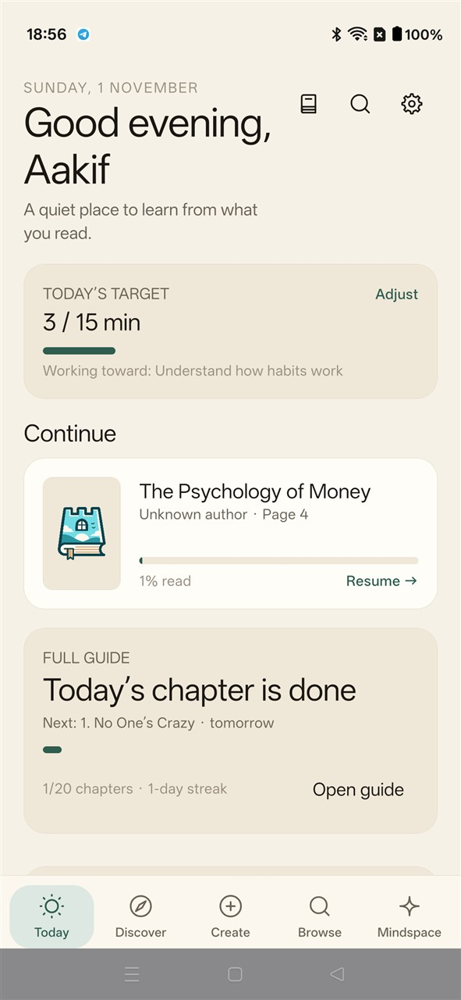
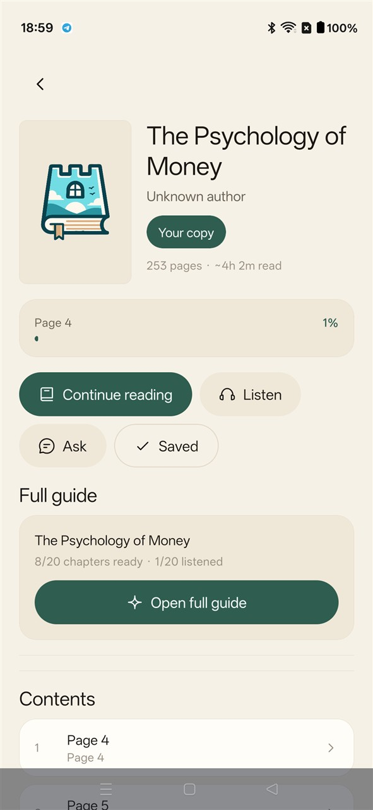
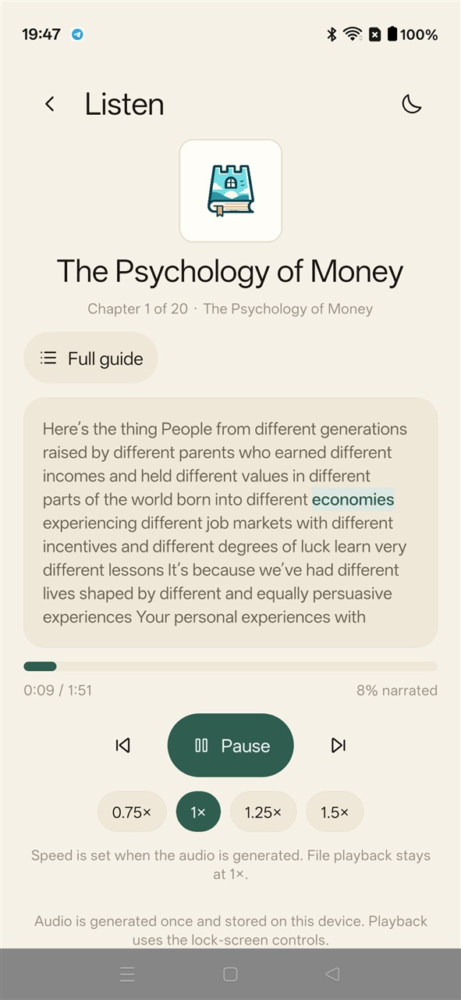
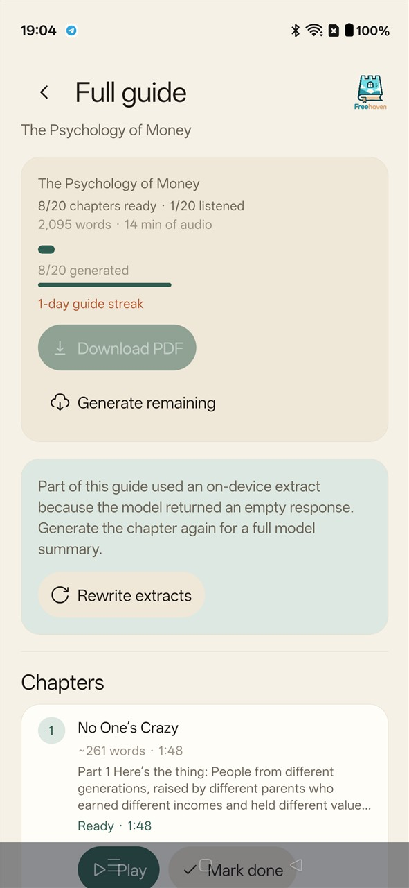
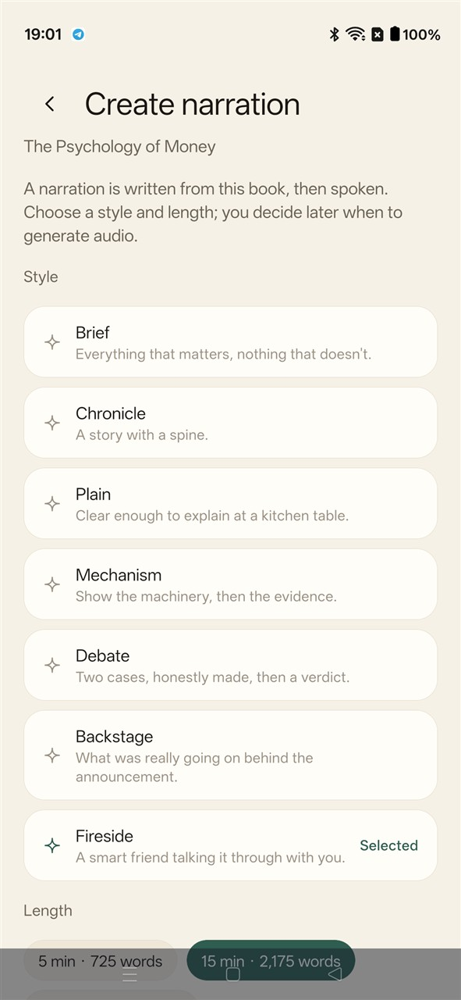
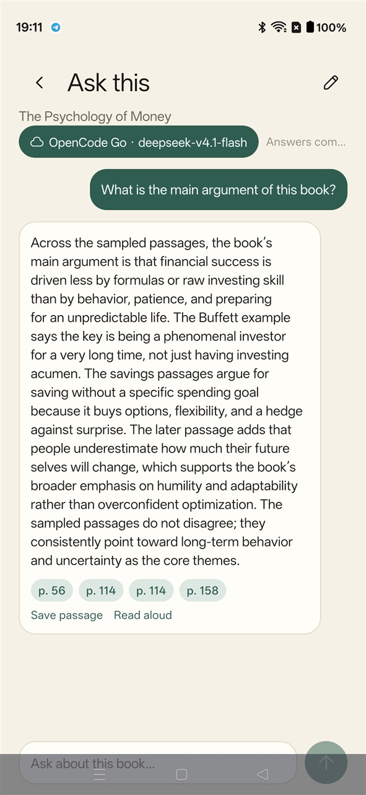
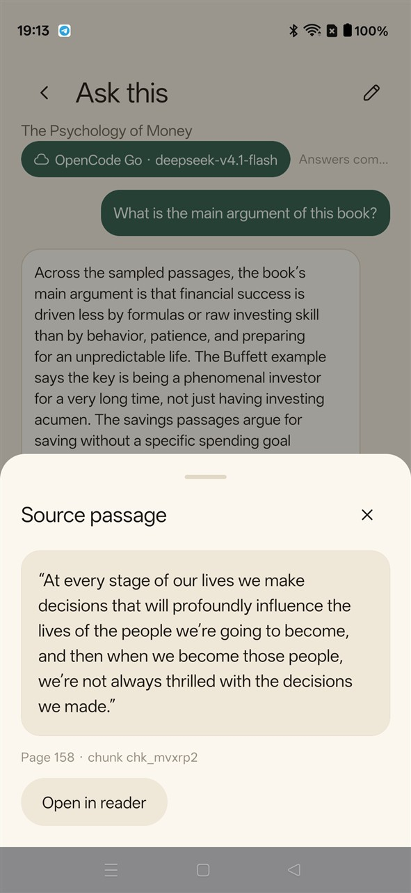
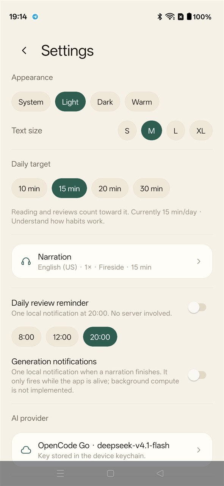
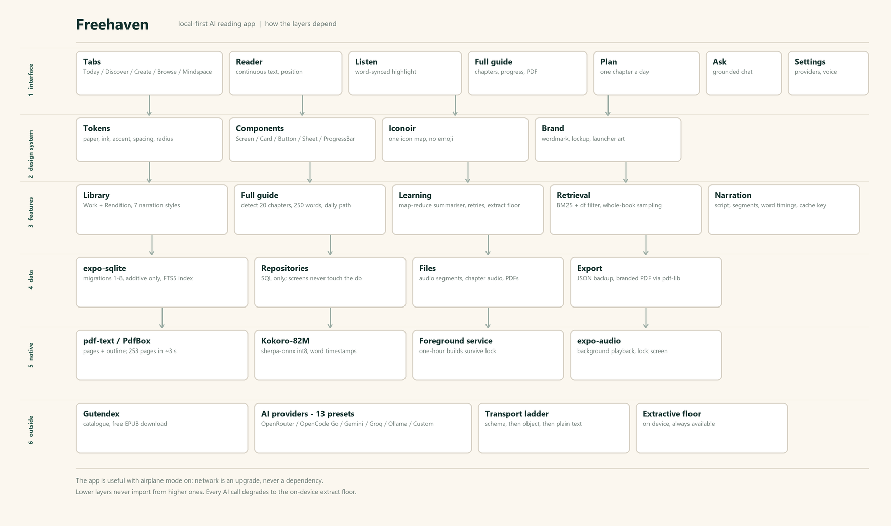
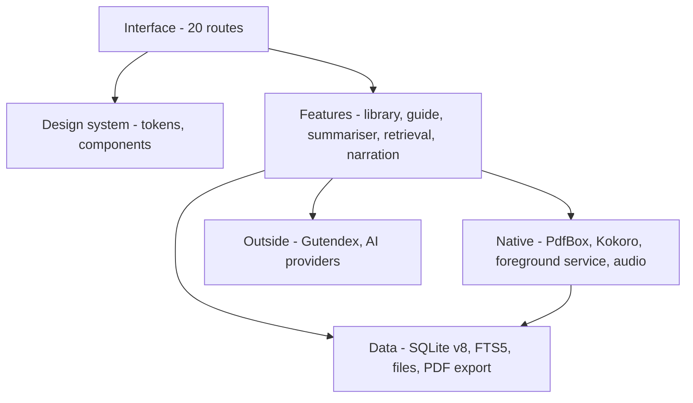

# Freehaven

**A local-first reading app that turns any book into a narrated, chapter-by-chapter guide.**

Most reading apps assume a store, an account and a connection. Freehaven assumes a PDF
on your phone. Import it, and the app extracts the text, finds the chapters, writes a
250-word summary of each one, narrates it with word-synced highlighting, and hands you
one chapter a day as a learning path. Everything lives in SQLite on the device; the only
traffic is the requests you trigger, to a model provider you chose.

<p>
  <a href="https://github.com/ItsAakif/freehaven/actions/workflows/android-beta.yml"></a>
  
  
  
  
</p>

https://github.com/user-attachments/assets/6f1f28d7-45dc-4162-8df1-104260b43ce8

<p align="center"><sub><b>27-second launch video</b></sub></p>

---

## Screens

Captured on a phone from the beta build, with one imported PDF and a full guide in
progress, because the interesting states are the ones with real work in them.

<table>
  <tr>
    <td align="center"><br><sub><b>Today</b> - target, continue reading, review queue</sub></td>
    <td align="center"><br><sub><b>Book</b> - cover, contents, full guide, renditions</sub></td>
  </tr>
  <tr>
    <td align="center"><br><sub><b>Reader</b> - continuous text, saved position</sub></td>
    <td align="center"><br><sub><b>Listen</b> - the word being spoken is the word on screen</sub></td>
  </tr>
  <tr>
    <td align="center"><br><sub><b>Full guide</b> - chapters, progress, PDF, per-chapter rewrite</sub></td>
    <td align="center"><br><sub><b>Create narration</b> - seven narration styles, one book</sub></td>
  </tr>
  <tr>
    <td align="center"><br><sub><b>Ask</b> - an answer grounded in the book, with citations</sub></td>
    <td align="center"><br><sub><b>Source</b> - the cited passage and the page it came from</sub></td>
  </tr>
  <tr>
    <td align="center"><br><sub><b>Browse</b> - the public-domain catalogue</sub></td>
    <td align="center"><br><sub><b>Settings</b> - provider, key, model, voice, target</sub></td>
  </tr>
</table>

---

## Why it exists

**Reading and listening are different products.** A book you own is a wall of text; a
book you can *listen to a chapter at a time* is a routine. Freehaven keeps the text and
produces the second thing from the first, on the device.

**A summary you cannot check is decoration.** Every narrated chapter and every answer
cites the passage it came from, and the citation opens that page. When a model returns
nothing usable, the app says so and shows an extract instead of inventing prose.

**Chapter structure is the hard part of a PDF.** A 253-page book has an outline, a
contents page, headings and page furniture. The importer uses the outline first, then
heading matching, then equal page groups - and lets you merge, split or exclude chapters
before anything is generated.

**A one-hour build must survive a locked screen.** Narration is real inference, not an
API call; the guide builder runs in a foreground service with checkpointed, resumable
chapters, so putting the phone down does not throw the work away.

---

## What's inside

| | |
|---|---|
| **Import** | PDF (native PdfBox), EPUB, plain text, HTML; charset detection, boilerplate removal, quality gate |
| **Catalogue** | Gutendex search, free EPUB download, one tap to import |
| **Library** | Work + Rendition model: one book, many narrations by style and length |
| **Reader** | Continuous text, section jumps, saved position, highlights and notes |
| **Listen** | Word-synced highlight, 0.75-1.5x rate, lock-screen controls, background playback |
| **Narration** | Seven scripts (brief, chronicle, plain, mechanism, debate, backstage, fireside), Kokoro-82M on device, Piper and remote as options |
| **Full guide** | Auto-detected chapters, 250 words each, one chapter a day, per-chapter audio, branded PDF |
| **Plans** | A guide becomes a 20-day path, with streaks and a Today card |
| **Ask** | Retrieval over the book's own chunks, grounded answers, verifiable citations |
| **Review** | Cards and spaced repetition from what you saved |
| **Export** | JSON backup, branded PDFs, storage report |

---

## Where to go

Five tabs, and the app is meant to be understood in this order:

1. **Today** - your target, the book you are reading, the review queue and (once a guide
   exists) *today's chapter*. This is the only screen most days need.
2. **Discover** - editorial rows built from the books you already have.
3. **Create** - the workbench: import a file, start a narration, build a full guide.
4. **Browse** - the Gutendex catalogue. Search a title, download the EPUB, import it.
5. **Mindspace** - everything you saved: highlights, notes, answers, review cards.

Inside a book: **Read** for the text, **Listen** for a narration, **Full guide** for the
chapter path, **Ask** for questions about that book. The gear is Settings - provider,
key, model, response format, voice, style, daily target.

First five minutes: Settings -> AI provider -> paste a key (or stay on the on-device
extractive engine, which needs nothing) -> Create -> import a PDF -> Book -> Create full
guide -> review the detected chapters -> Create.

---

## Architecture



Six layers, each only knowing the one below it:

| Layer | What lives there | Rule |
|---|---|---|
| Interface | Expo Router, 20 routes | Screens compose; they never run SQL |
| Design system | tokens, components, Iconoir map | No literal hex, fontSize or radius in a screen |
| Features | library, full guide, summariser, retrieval, narration | Pure logic; no React imports |
| Data | expo-sqlite schema v8 (33 tables, FTS5), files, exporters | Additive migrations only |
| Native | PdfBox module, Kokoro via sherpa-onnx, foreground service, expo-audio | One Expo module per capability |
| Outside | Gutendex, 13 AI providers | Optional; the app works with airplane mode on |



**Why the AI is a feature layer, not a god object.** Retrieval, prompting, JSON repair
and the extractive floor live behind one provider interface. The summariser, the guide
builder and Ask all call that interface and never touch HTTP; swapping a provider is a
preset row, not a code path.

---

## Tech stack

| | |
|---|---|
| **Runtime** | React Native 0.88.1, React 19.3, Expo SDK 58, TypeScript 6 |
| **Navigation** | Expo Router, 20 routes, file-based |
| **State** | Zustand for UI preferences; SQLite for everything durable |
| **Storage** | expo-sqlite with FTS5, schema v8, eight additive migrations, 33 tables |
| **Audio** | expo-audio for playback, react-native-sherpa-onnx running Kokoro-82M int8 |
| **Native** | Kotlin module wrapping Apache PdfBox for page text and the document outline |
| **AI** | Bring your own key against 13 presets (OpenRouter, OpenCode Go, Gemini, Groq, OpenAI, DeepSeek, Mistral, Cerebras, Together, Fireworks, Ollama, LM Studio, custom), stored per provider |
| **Documents** | pdf-lib for branded PDFs, JSZip + fast-xml-parser + pako for EPUB |
| **Icons / art** | iconoir-react-native, one icon map; hand-drawn mark and launcher art |
| **Checks** | Jest 30 (73 suites, 621 tests), tsc, ESLint 9, Expo Doctor |
| **CI** | GitHub Actions: typecheck, lint, tests, prebuild, Gradle release APK, artefact upload |

---

## How the AI is wired

**The provider is a preset, not an import.** `src/ai/presets.ts` describes each endpoint:
base URL, default model, capabilities (JSON schema, JSON object, system role, context
budget) and notes. The transport walks a ladder - structured output, then JSON object,
then plain text - retries once on an empty body, repairs malformed JSON, and falls back
to the on-device extractive engine. A provider that is down degrades the answer; it never
breaks the screen.

**Retrieval is lexical and honest.** Chunks are indexed in FTS5 and ranked with BM25.
A term that appears in more than 40% of the book ("book", "money") is dropped from the
query, because those terms rank randomly. Questions about the book as a whole - "what is
the main argument" - do not run a query at all: they sample passages evenly across the
beginning, middle and end so the answer is about the book rather than page 215.

**The model writes; the app decides.** Summaries must pass a word budget (212-287 words
for a 250-word chapter), a retry, and a trim. When a model returns nothing, the chapter is
stored as an extract and marked `+extract`, and the guide screen offers a rewrite. Nothing
is silently presented as model prose when it was not.

**Timings are real.** Narration requests word-level subtitles from the engine and stores
them with the audio, so the player highlights the word being spoken instead of guessing
from character counts.

---

## Verification

```bash
npx tsc --noEmit
npx eslint .
npx jest --runInBand
```

`73 suites, 621 tests`, covering the schema and migrations, chapter detection on a real
253-page PDF, the word budget and retry path, the guide runner (failure isolation,
cancel, resume, foreground lifecycle), plan ordering, FTS5 retrieval, provider transport,
JSON repair, per-provider key storage, PDF layout, and the reader's position maths.

Each of these exists because it caught something: a foreign key written before its
parent on import, a cancelled guide marking a half-synthesised chapter ready, a chapter
list that remounted every second and ate taps, citations that landed on page 4, and a
notes call truncated at 700 tokens that quietly turned every chapter into an extract.

---

## Layout

```
src/app/            20 routes (tabs, book, reader, listen, guide, plan, chat, settings)
src/design/         tokens, theme, components, brand, icon map
src/domain/         types, text, retrieval, guides, narration
src/data/           schema + migrations, repositories (SQL only)
src/features/       imports, guides, narration, learning, export, jobs
src/ai/             presets, transport, planning, JSON repair, citations, keys, extractive
modules/pdf-text/   Kotlin + PdfBox Expo module
img/                screenshots and the architecture diagram
.github/workflows/  android-beta.yml
```

---

## Build

The native project is generated per build; `android/` is not committed.

```bash
npx expo prebuild --platform android
cd android && ./gradlew assembleRelease
```

No local SDK? Push to `beta` - `.github/workflows/android-beta.yml` typechecks, lints,
runs the suite, builds the release APK and uploads it as a workflow artefact.

---

## Known limitations

- The beta APK is signed with the debug key and built for arm64-v8a; it side-loads and
  updates over itself, but it is not Play Store submittable.
- Kokoro narration runs at roughly 1.5x realtime on a mid-range phone - a 20-chapter
  guide is about an hour of inference. Remote TTS is faster but sends text to a provider.
- PDF chapter detection is only as good as the document's outline. A book with no outline
  falls back to equal page groups that you have to correct by hand, and scanned PDFs
  without a text layer are not OCR'd.
- The catalogue is Gutendex only. Books that are not public domain must be imported as
  files.
- No cross-device sync, no account, no analytics. A JSON backup is the portability story.
- AI quality depends entirely on the model you point at it. Free tiers are shared and
  will answer "try another model" under load; the app degrades, it does not retry forever.

---

## Licence

MIT. Third-party notices for PdfBox, Kokoro and sherpa-onnx are in
[THIRD_PARTY_NOTICES.md](THIRD_PARTY_NOTICES.md).

This is a reading and learning tool, not financial, medical or legal advice.


